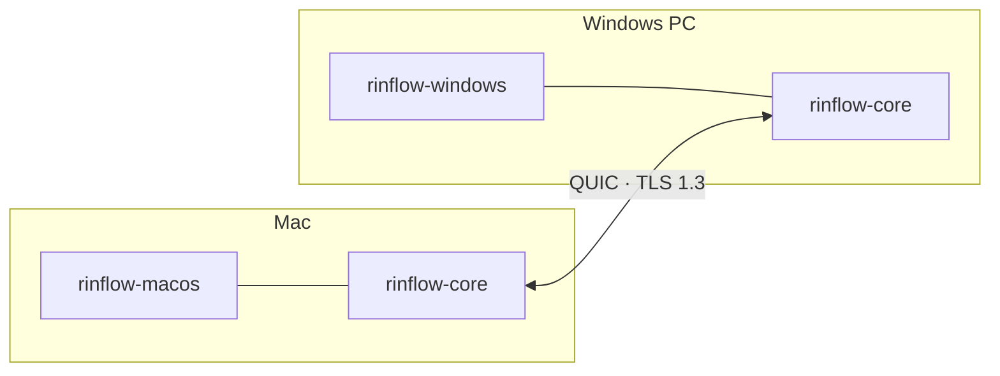

<p align="center">
  <picture>
    <source media="(prefers-color-scheme: dark)" srcset="docs/images/logo-dark.svg">
    
  </picture>
</p>

<h1 align="center">Rinflow Core</h1>

<p align="center">
  Rinflow を支える Rust ライブラリです。デバイスの検出、暗号化接続、入力の同期により、<br>
  複数のコンピューターで 1 組のキーボードとマウスを共有できるようにします。
</p>

<p align="center">
  <a href="README.md">English</a> · <a href="README.zh-CN.md">简体中文</a> · <b>日本語</b>
</p>

> [!NOTE]
> Rinflow は開発初期の段階です。C ABI と通信プロトコルは、バージョン間で変わる可能性があります。

## 概要

各プラットフォームの Rinflow アプリは入力をネイティブにキャプチャして注入し、ネットワークを介する処理はすべてこのライブラリが担います。



| 分野 | コアの役割 |
| --- | --- |
| デバイスの検出 | UDP マルチキャスト（ブロードキャストで補完）またはアドレス指定でデバイスを検出 |
| 接続 | QUIC + TLS 1.3、デバイスごとに 1 つのセッション、6 桁のコードによるペアリング |
| 入力 | 順序を保ってまとめて送る入力イベント。セッション終了時に押されたままのキーを解放 |
| デバイスの配置 | 各デバイスの位置を同期し、そこへつながる画面の端を算出 |
| クリップボードとファイル | 専用のデータ リンク。コピーしたファイルは必要なときに読み取り |
| バインディング | C ABI（[`include/rinflow_core.h`](include/rinflow_core.h)）、Rust API、Android JNI |

## クライアント

- [Rinflow for macOS](https://github.com/rinflow-dev/rinflow-macos)
- [Rinflow for Windows](https://github.com/rinflow-dev/rinflow-windows)

どちらもこのライブラリをソースからビルドし、隣のフォルダーに `rinflow-core` という名前で置かれていることを前提としています。

## ビルド

Rust 1.88 以降が必要です。

```sh
cargo build --release
cargo test
```

ビルドすると `target/` に Rust ライブラリ、静的ライブラリ、動的ライブラリが生成されます。一部のテストは 2 つの実際のコアを起動し、UDP マルチキャストで互いを検出するため、マルチキャストのループバックに対応したネットワーク インターフェースが必要です。

## C API の使い方

```c
LcCore *core = lc_core_create(config_json, on_event, on_input, context);
lc_core_connect(core, peer_id);     // 検出したデバイスとセッションを開始
lc_core_send_input(core, &event);   // キャプチャした入力を送信
lc_core_destroy(core);
```

イベントは JSON 文字列として、コアのスレッド上で通知されます。すべての呼び出し、設定、イベントは [C API](docs/c-api.md) をご覧ください。

## ドキュメント（英語）

- [アーキテクチャ](docs/architecture.md)：デバイスの検出、セッション、入力、デバイスの配置
- [C API](docs/c-api.md)：呼び出し、設定、イベント、入力の規約
- [通信プロトコル](docs/protocol.md)
- [セキュリティ設計](docs/security.md)
- [クリップボードとファイル](docs/clipboard-and-files.md)（中国語）

## コントリビュート

[CONTRIBUTING.md](CONTRIBUTING.md) をご覧ください。脆弱性の報告については [SECURITY.md](SECURITY.md) をご覧ください。

## ライセンス

[Mozilla Public License 2.0](LICENSE)
