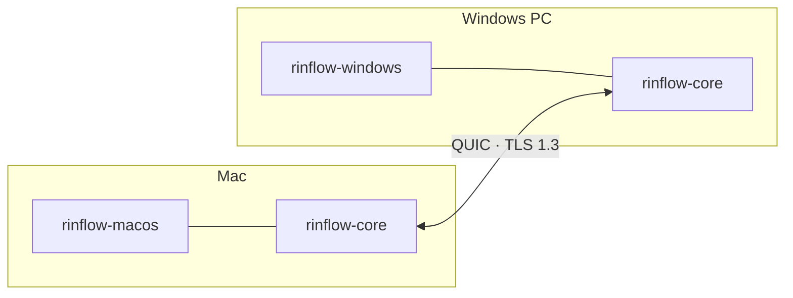

<p align="center">
  <picture>
    <source media="(prefers-color-scheme: dark)" srcset="docs/images/logo-dark.svg">
    
  </picture>
</p>

<h1 align="center">Rinflow Core</h1>

<p align="center">
  The Rust library behind Rinflow: device discovery, encrypted connections<br>
  and input sync for sharing one keyboard and mouse across computers.
</p>

<p align="center">
  <b>English</b> · <a href="README.zh-CN.md">简体中文</a> · <a href="README.ja.md">日本語</a>
</p>

> [!NOTE]
> Rinflow is in early development. The C ABI and the wire protocol may still change between versions.

## Overview

Each Rinflow app captures and injects input natively, and links this library for everything that crosses the network.



| Area | What the core does |
| --- | --- |
| Discovery | Finds devices by UDP multicast with a broadcast fallback, or by address |
| Connections | QUIC with TLS 1.3, one session per device, six-digit pairing |
| Input | Ordered, batched input events; held keys are released when a session ends |
| Arrangement | Syncs where each device sits, and works out the screen edges that lead to it |
| Clipboard and files | A separate data link; copied files are read on demand |
| Bindings | C ABI ([`include/rinflow_core.h`](include/rinflow_core.h)), a Rust API and Android JNI |

## Clients

- [Rinflow for macOS](https://github.com/rinflow-dev/rinflow-macos)
- [Rinflow for Windows](https://github.com/rinflow-dev/rinflow-windows)

Downloads: [macOS](https://github.com/rinflow-dev/rinflow-macos/releases/latest) · [Windows](https://github.com/rinflow-dev/rinflow-windows/releases/latest)

Both build this library from source and expect it in a folder named `rinflow-core` next to their own.

## Building

Requires Rust 1.88 or later.

```sh
cargo build --release
cargo test
```

`target/` then holds a Rust library, a static library and a dynamic library. Some tests start two real cores that find each other over UDP multicast, so they need a network interface that allows multicast loopback.

## Using the C API

```c
LcCore *core = lc_core_create(config_json, on_event, on_input, context);
lc_core_connect(core, peer_id);     // open a session with a discovered device
lc_core_send_input(core, &event);   // forward captured input to it
lc_core_destroy(core);
```

Events arrive as JSON strings on the core's own threads. See the [C API](docs/c-api.md) for every call, the configuration and the events.

## Documentation

- [Architecture](docs/architecture.md): discovery, sessions, input and arrangement
- [C API](docs/c-api.md): calls, configuration, events and input conventions
- [Wire protocol](docs/protocol.md)
- [Security design](docs/security.md)
- [Clipboard and files](docs/clipboard-and-files.md) (in Chinese)

## Contributing

See [CONTRIBUTING.md](CONTRIBUTING.md). To report a vulnerability, see [SECURITY.md](SECURITY.md).

## License

[Mozilla Public License 2.0](LICENSE)
