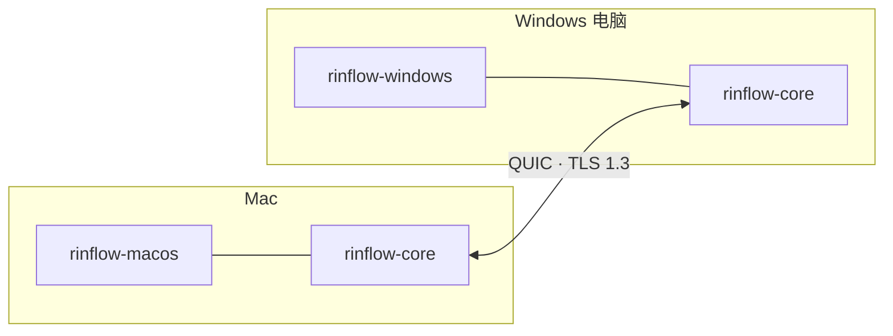

<p align="center">
  <picture>
    <source media="(prefers-color-scheme: dark)" srcset="docs/images/logo-dark.svg">
    
  </picture>
</p>

<h1 align="center">Rinflow Core</h1>

<p align="center">
  Rinflow 的 Rust 核心库：设备发现、加密连接和输入同步，<br>
  让多台电脑共用一套键盘和鼠标。
</p>

<p align="center">
  <a href="README.md">English</a> · <b>简体中文</b> · <a href="README.ja.md">日本語</a>
</p>

> [!NOTE]
> Rinflow 处于早期开发阶段，C ABI 和通信协议在版本之间仍可能变化。

## 概览

各平台的 Rinflow 应用以原生方式捕获和注入输入，所有跨网络的工作都交给本库完成。



| 模块 | 核心库负责的工作 |
| --- | --- |
| 设备发现 | 通过 UDP 组播（广播兜底）或指定地址查找设备 |
| 连接 | QUIC + TLS 1.3，每台设备一个会话，六位配对码 |
| 输入 | 有序、批量的输入事件；会话结束时自动释放按住的键 |
| 设备排列 | 同步每台设备的位置，并算出通往它的屏幕边缘 |
| 剪贴板和文件 | 独立的数据链路；复制的文件按需读取 |
| 接口 | C ABI（[`include/rinflow_core.h`](include/rinflow_core.h)）、Rust API 和 Android JNI |

## 客户端

- [Rinflow for macOS](https://github.com/rinflow-dev/rinflow-macos)
- [Rinflow for Windows](https://github.com/rinflow-dev/rinflow-windows)

两者都从源码构建本库，并要求它放在同级目录下名为 `rinflow-core` 的文件夹中。

## 构建

需要 Rust 1.88 或更高版本。

```sh
cargo build --release
cargo test
```

构建后 `target/` 中会有 Rust 库、静态库和动态库。部分测试会启动两个真实的核心实例，通过 UDP 组播互相发现，因此需要支持组播回环的网络接口。

## 使用 C API

```c
LcCore *core = lc_core_create(config_json, on_event, on_input, context);
lc_core_connect(core, peer_id);     // 与发现的设备建立会话
lc_core_send_input(core, &event);   // 把捕获的输入发给它
lc_core_destroy(core);
```

事件以 JSON 字符串的形式在核心库自己的线程上回调。完整的调用、配置和事件见 [C API](docs/c-api.md)。

## 文档（英文）

- [架构](docs/architecture.md)：设备发现、会话、输入和设备排列
- [C API](docs/c-api.md)：调用、配置、事件和输入约定
- [通信协议](docs/protocol.md)
- [安全设计](docs/security.md)
- [剪贴板和文件](docs/clipboard-and-files.md)（中文）

## 参与贡献

见 [CONTRIBUTING.md](CONTRIBUTING.md)。报告安全漏洞见 [SECURITY.md](SECURITY.md)。

## 许可证

[Mozilla Public License 2.0](LICENSE)
